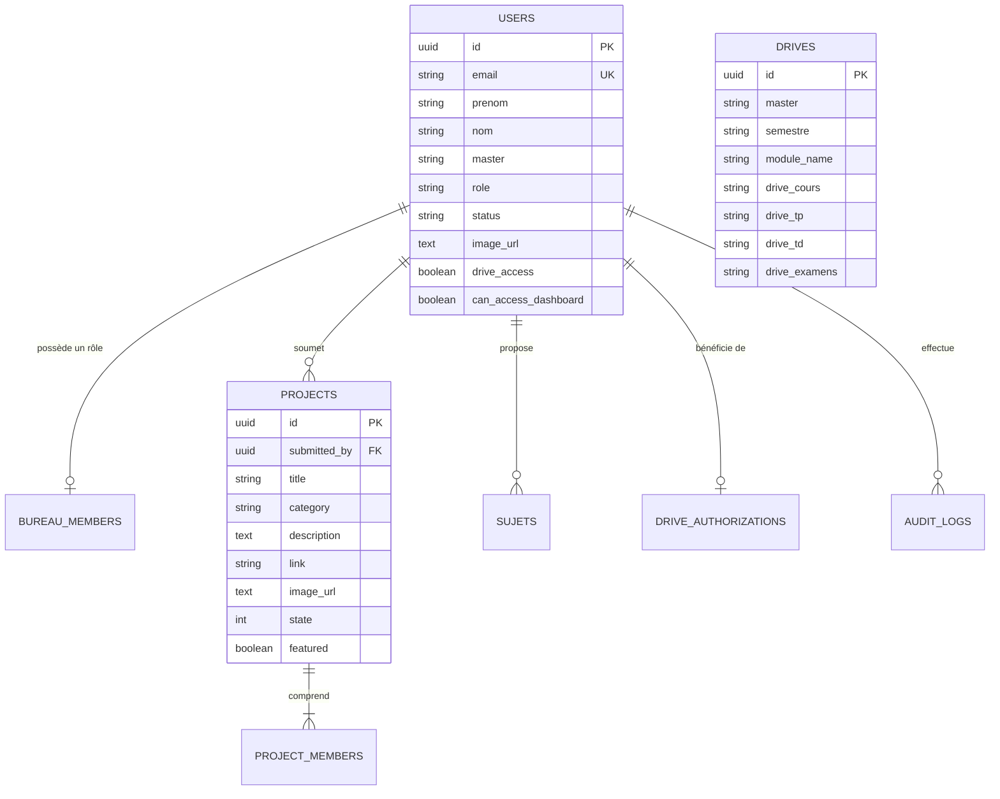

# Modélisation Complète de la Base de Données & Guide Supabase
## Club d'Intelligence Artificielle et ses Applications (CIAA - FSAN Nador)
### Faculté des Sciences Appliquées de Nador · Université Mohammed Premier (UMP)
*Masters d'Excellence : SDSI (Science des Données & Systèmes Intelligents) & MIATE (IA & Technologies Émergentes)*

---

## 1. Modèle Conceptuel des Données (MCD)

### 1.1 Entités Principales
* **`USERS`** : Étudiants inscrits, professeurs encadrants et administrateurs.
* **`BUREAU_MEMBERS`** : Les 8 rôles officiels de gouvernance (2 Professeurs Encadrants, Président, Vice-Présidente, Trésorier, Vice-Trésorière, 2 Responsables Réseaux Sociaux).
* **`PROJECTS`** : Projets IA réalisés, avec code source (GitHub), statut de modération (`state`) et mise en vedette Top 3 (`featured`).
* **`PROJECT_MEMBERS`** : Contributeurs et étudiants membres de chaque équipe de projet.
* **`SUJETS`** : Sujets de recherche et projets proposés nécessitant validation par l'administrateur.
* **`DRIVES`** : Ressources Google Drive par module et semestre (S1, S2, S3) avec 4 sous-dossiers (Cours, TP, TD, Examens).
* **`DRIVE_AUTHORIZATIONS`** : Gestion des accès sécurisés par email académique institutionnel (`@ump.ac.ma`).
* **`VIDEOS`** : Catalogue Supabase de vidéos en ligne, classées par parcours.
* **`MESSAGES`** : Boîte de réception des messages avec réponses courriel intégrées.
* **`SITE_SETTINGS`** : Paramètres du club, missions et liens des réseaux sociaux officiels.
* **`AUDIT_LOGS`** : Journalisation d'audit des actions de modération administrateur.



---

## 2. Modèle Logique des Données (MLD Normalisé 3NF)

1. **`users`** (`id` [PK], `email` [UK], `prenom`, `nom`, `master`, `role`, `status`, `linkedin`, `bio`, `image_url`, `drive_access`, `can_access_dashboard`, `created_at`, `updated_at`)
2. **`bureau_members`** (`id` [PK], `user_id` [FK nullable], `role_key` [UK], `role_label`, `category`, `prenom`, `nom`, `affiliation`, `email`, `linkedin`, `description`, `can_access_dashboard`, `display_order`, `created_at`, `updated_at`)
3. **`projects`** (`id` [PK], `submitted_by` [FK nullable], `title`, `category`, `description`, `link`, `image_url`, `tags`, `state`, `featured`, `views_count`, `created_at`, `updated_at`)
4. **`project_members`** (`id` [PK], `project_id` [FK], `user_id` [FK nullable], `name`, `linkedin`, `role_in_team`, `created_at`)
5. **`sujets`** (`id` [PK], `user_id` [FK nullable], `member_name`, `member_email`, `title`, `category`, `target_master`, `team_size`, `technologies`, `description`, `image_url`, `status`, `created_at`, `updated_at`)
6. **`drives`** (`id` [PK], `master`, `semestre`, `module_name`, `description`, `image_url`, `drive_cours`, `drive_tp`, `drive_td`, `drive_examens`, `created_at`, `updated_at`)
7. **`drive_authorizations`** (`id` [PK], `user_id` [FK], `academic_email`, `access_status`, `granted_at`, `updated_at`)
8. **`videos`** (`id` [PK], `title`, `track`, `category_name`, `youtube_id`, `youtube_url`, `duration`, `instructor`, `description`, `image_url`, `display_order`, `created_at`, `updated_at`)
9. **`messages`** (`id` [PK], `sender_name`, `sender_email`, `sender_role`, `subject`, `message`, `status`, `reply_content`, `replied_at`, `replied_by` [FK nullable], `created_at`)
10. **`site_settings`** (`id` [PK CHECK id=1], `club_name`, `short_name`, `faculty`, `university`, `email`, `address`, `description`, `mission`, `linkedin_url`, `youtube_url`, `github_url`, `discord_url`, `instagram_url`, `updated_at`)
11. **`audit_logs`** (`id` [PK], `admin_id` [FK nullable], `action_type`, `target_table`, `target_id`, `details` [JSONB], `created_at`)

---

## 3. Éléments Essentiels de la Base de Données

### 3.1 Index Optimisés
* **Index B-Tree** sur les filtres fréquents : `users(status)`, `projects(state)`, `drives(master, semestre)`.
* **Index Partiel Spécifique (Top 3 Accueil)** :
  ```sql
  CREATE INDEX idx_projects_top3 ON projects(featured, created_at DESC) 
  WHERE state = 1 AND featured = TRUE;
  ```
* **Index GIN Trigrammes (`pg_trgm`)** pour la recherche textuelle rapide :
  ```sql
  CREATE INDEX idx_projects_title_trgm ON projects USING gin (title gin_trgm_ops);
  CREATE INDEX idx_drives_module_trgm ON drives USING gin (module_name gin_trgm_ops);
  ```

### 3.2 Vues SQL (Views)
* **`v_top3_projects`** : renvoie directement les 3 meilleurs projets avec la liste JSON agrégée des membres de l'équipe pour la page d'accueil (`index.html`).
* **`v_approved_projects`** : galerie publique de tous les projets validés avec leurs métadonnées.
* **`v_bureau_official`** : les 8 membres officiels et professeurs encadrants ordonnés par hiérarchie.
* **`v_dashboard_kpis`** : calcul en une seule requête de l'ensemble des compteurs clés du tableau de bord.

### 3.3 Triggers (Déclencheurs)
1. **Mise à jour automatique des dates** (`trg_users_updated`, `trg_projects_updated`) via `fn_trigger_set_timestamp()`.
2. **Contrôle d'intégrité Top 3** (`trg_projects_top3_limit`) : garantit qu'il n'y a jamais plus de 3 projets simultanément en vedette.
3. **Audit automatique** (`trg_audit_project_state`) : écrit dans `audit_logs` dès qu'un admin valide ou rejette un projet.
4. **Attribution automatique d'accès Drive** (`trg_user_approval_drive`) : accorde immédiatement l'accès Drive aux étudiants validés avec un email `@ump.ac.ma`.

### 3.4 Procédures Stockées avec Curseurs Explicites (Cursors)
```sql
CREATE OR REPLACE FUNCTION fn_process_pending_users_cursor(
    p_auto_approve_ump BOOLEAN DEFAULT TRUE
)
RETURNS TABLE (processed_count INT, approved_count INT, summary_message TEXT) AS $$
DECLARE
    -- Déclaration explicite du Curseur
    cur_pending_users CURSOR FOR 
        SELECT id, prenom, nom, email, master 
        FROM users 
        WHERE status = 'pending' 
        ORDER BY created_at ASC;

    v_user_record RECORD;
    v_total_processed INT := 0;
    v_total_approved INT := 0;
BEGIN
    OPEN cur_pending_users;
    LOOP
        FETCH cur_pending_users INTO v_user_record;
        EXIT WHEN NOT FOUND;

        v_total_processed := v_total_processed + 1;

        IF p_auto_approve_ump AND v_user_record.email ~* '@ump\.ac\.ma$' THEN
            UPDATE users 
            SET status = 'approved', drive_access = TRUE, updated_at = NOW() 
            WHERE id = v_user_record.id;

            v_total_approved := v_total_approved + 1;
        END IF;
    END LOOP;
    CLOSE cur_pending_users;

    processed_count := v_total_processed;
    approved_count := v_total_approved;
    summary_message := format('%s candidatures traitées, %s validées.', v_total_processed, v_total_approved);
    RETURN NEXT;
END;
$$ LANGUAGE plpgsql;
```

### 3.5 Sécurité Row Level Security (RLS)
* **Lecture Publique (`SELECT`)** sur les projets validés (`state = 1`), les modules Drive, les vidéos et les paramètres du club.
* **Insertion Publique (`INSERT`)** pour les inscriptions d'étudiants, les propositions de sujets et les messages de contact.
* **Contrôle Total (`ALL`)** réservé aux administrateurs sur le Dashboard.

---

## 4. Déploiement en 3 Étapes sur Supabase Gratuit

1. **Créer le projet** sur [supabase.com](https://supabase.com) (Tier Gratuit : 500 Mo PostgreSQL, 50 000 utilisateurs).
2. **Exécuter le script** : Ouvrez l'onglet **SQL Editor**, collez le contenu du fichier [`database_schema.sql`](./database_schema.sql) et cliquez sur **Run**.
3. **Connecter le site web** : La configuration Supabase est définie dans `js/supabase-client.js`. Le panneau **⚡ Backend Supabase** du Dashboard permet de vérifier la connexion ou de saisir une autre URL et clé `anon`.

### Architecture de données actuelle
Le site utilise Supabase pour les données métier et l'authentification. Il n'existe plus de jeu de démonstration, de stockage local des enregistrements ni de synchronisation hors ligne. Les tableaux Supabase sont créés vides; les contenus visibles sont ceux publiés dans ces tables. La progression des vidéos n'est conservée que pendant la session de navigation.

Le script [`database_schema.sql`](./database_schema.sql) supprime d'abord les tables et vues existantes avant de les recréer. Il est prévu pour une installation neuve et efface les données si vous l'exécutez sur une base existante. Après création, inscrivez un premier compte puis promouvez-le depuis l'éditeur SQL Supabase :

```sql
UPDATE public.users
SET role = 'admin', status = 'approved', can_access_dashboard = TRUE
WHERE email = 'adresse-administrateur@ump.ac.ma';
```

Ne placez jamais de clé `service_role` dans le site. Utilisez uniquement l'URL du projet et la clé publique `anon`/`publishable`.
